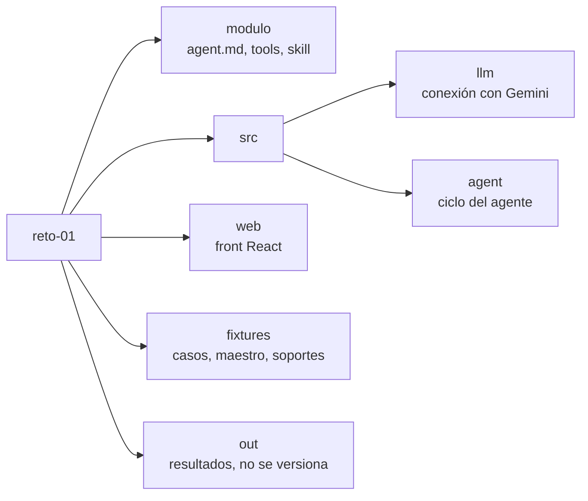

# Agente "Registro como Proveedor"

Es mi solución al reto técnico 01. Un agente conversacional lee la solicitud de un cliente, llena el formulario con los datos de la empresa, arma el paquete de soportes para firma y nunca envía nada sin que una persona lo confirme. El diseño, las decisiones y la cobertura del PRD están en `SOLUCION.md`.

## Cómo levantarlo

Necesitas Bun 1.4 o superior (https://bun.sh).

```bash
bun install
cp .env.example .env
bun run dev
```

En PowerShell el segundo comando es `copy .env.example .env`. Después abre `.env` y pega tu clave de Gemini en `GEMINI_API_KEY` (se saca gratis en https://aistudio.google.com/apikey). El backend queda en el puerto 3000 y el front en http://localhost:5173.

## Variables de entorno

Todas están en `.env.example`, con sus valores por defecto:

- `GEMINI_API_KEY`: la clave del modelo. Solo la lee el backend. Es la única obligatoria.
- `LLM_MODEL` y `LLM_MODEL_RESPALDO`: el modelo principal (gemini-3.6-flash) y el de respaldo (gemini-3.1-flash-lite).
- `MAX_PASOS`: cuántas idas y vueltas con el modelo se permiten por mensaje (8).
- `MAX_TOKENS_SESION`: tope de tokens por conversación (150000).
- `FECHA_EJECUCION`: la fecha contra la que se revisan las vigencias de los soportes, en formato AAAA-MM-DD. Vacía usa 2026-09-03, la fecha del PRD, para que el resultado sea siempre el mismo.
- `PORT`: el puerto del servidor (3000).

## Comandos

- `bun run dev`: backend y front a la vez, con recarga.
- `bun run build:web` y luego `bun run start`: compila el front y lo sirve junto con la API en un solo puerto.
- `bun run demo`: corre todas las herramientas sobre los 4 casos, sin modelo ni clave.
- `bun run chat`: chat por terminal con el agente; muestra los tokens usados.
- `bun test`: las pruebas automáticas, con un modelo simulado y sin clave.
- `bun run typecheck`: revisa los tipos del backend y del front.
- `bun run modelos`: lista y prueba los modelos disponibles para tu clave.

## Probarlo

Con el servidor en marcha, escribe en el chat (al arrancar, el servidor deja armados los paquetes de los 4 casos; no hace falta correr el demo antes):

```
Procesa el caso "ec-corp-andina". Dime qué campos quedaron llenos, cuáles
faltan, si el paquete está listo para firma y qué soportes debo actualizar.
No envíes nada todavía.
```

Con la fecha por defecto deberías ver los casos de Colombia y Panamá listos, el de Ecuador bloqueado (falta el certificado de cumplimiento tributario) y el de Honduras bloqueado (parafiscales vencidos). Los archivos quedan en `out/<caso>/` y se descargan desde el panel de la derecha.

Si respondes "confirmo el envío" con un caso listo, el agente escribe `ENVIO-SIMULADO.md`. No envía nada real.

## Link de prueba

Pendiente de despliegue.

## Qué hay en cada carpeta



El servidor está en `src/server.ts` y las pruebas en `src/pruebas/`.

## El módulo exportable

La carpeta `modulo/` trae el agente empaquetado para usarlo en otras plataformas sin mi servidor: `agent.md` (el prompt), `tools/proveedor.ts` (las 5 herramientas) y `skill/registro-proveedor/SKILL.md` (el conocimiento del proceso). Son los mismos archivos que usa esta aplicación, no copias. Para cambiar el prompt o el conocimiento se edita ahí.
