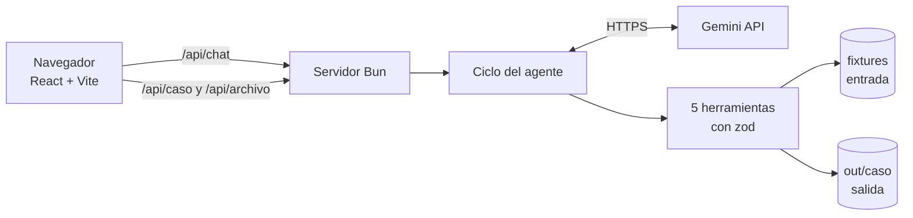
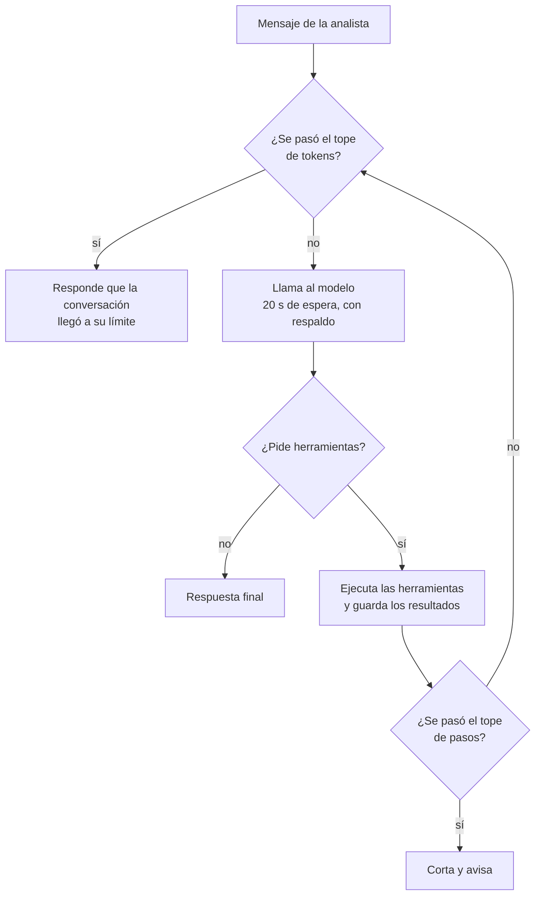
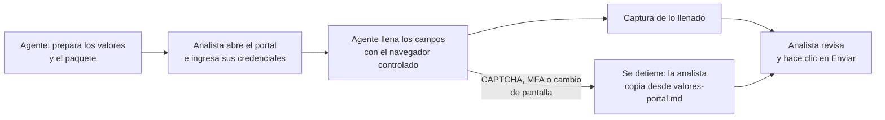

# Solución: agente - Registro como Proveedor

## 1. El problema

La analista administrativa de Periferia pasa buena parte del mes copiando a mano los mismos datos de la empresa en formularios de distintos clientes (Excel, PDF o portales web) y buscando cada soporte para ver si sigue vigente. Son entre 8 y 12 formularios al mes y el conocimiento de qué pide cada país está en la cabeza de una sola persona.

En la solución propuesta por el reto, planteo la construcción de un agente que lea la solicitud, llene el formulario desde el repositorio maestro, arme el paquete de soportes y deja todo listo para la firma. El agente nunca firma ni envía, eso lo decide una persona.

## 2. Arquitectura

El panel de la derecha de la pantalla (el expediente) no usa el modelo: llama directamente a las herramientas, así que siempre muestra el estado real del caso aunque Gemini falle, al arrancar, el servidor arma los paquetes que falten o que se hayan calculado con otra fecha (`src/preparar.ts`), con las mismas herramientas, para que el panel no quede vacío y no haya que correr el demo antes.

Dónde esta cada proceso:

- El prompt está en `modulo/agent.md`
- La construcción del proceso está en `modulo/skill/registro-proveedor/SKILL.md` y se une al prompt en `src/agent/sistema.ts`.
- Las herramientas están en `modulo/tools/proveedor.ts`, acá encontramos las funcionalidades para leer archivos, mapear los campos y generar los formularios están en `datos.ts`, `mapeo.ts` y `formularios.ts`, en la misma carpeta.
- El ciclo del agente está en `src/agent/loop.ts`.
- La conexión con el modelo está en `src/llm/` (un contrato en `adapter.ts` y la implementación de Gemini en `gemini.ts`).

La idea central es que el modelo conversa y decide qué herramienta llamar, pero los valores los decide el código, el mapeo de cada etiqueta al maestro, la vigencia de los soportes y el estado "listo para firma" son código determinista que el modelo no puede cambiar.

## 3. Ciclo del agente

Por cada mensaje, `responder()` agrega el mensaje al historial, llama al modelo con el prompt y las herramientas, ejecuta lo que el modelo pida y vuelve a llamarlo hasta que responda con texto.

Los topes y las protecciones:

- Pasos: `MAX_PASOS` (8 por defecto) idas y vueltas por mensaje.
- Tokens: `MAX_TOKENS_SESION` (150 000 por defecto) por conversación, estos se suman con lo que Gemini reporta en cada respuesta; al llegar al tope el agente deja de llamar al modelo.
- Timeout y respaldo: 20 segundos por llamada, si el modelo principal se demora, devuelve 429 o un error 5xx, se prueba el modelo de respaldo. Los errores que otro modelo no arregla (clave inválida, 403, 404) se informan sin reintentar.
- Llamadas repetidas: si el modelo pide exactamente la misma herramienta con los mismos argumentos dentro del mismo mensaje, se reutiliza el resultado.
- La confirmación humana está en el código, no solo en el prompt, en el momento de querer simular un envio, el valor de confirmación lo pone el código, nunca el modelo, y solo es verdadero si el mensaje de la analista confirma ("confirmo", "envíalo", o un "sí" justo después de que el agente pidió confirmación) y no contiene un "no", sin eso la herramienta responde "requiere confirmación explícita".
- Los errores no rompen nada: cada herramienta valida sus argumentos con zod, atrapa las excepciones y devuelve `{ ok, data }` o `{ ok: false, error }`. Cada llamada queda en `out/log.jsonl` y en `out/<caso>/log.jsonl`.
- Los datos bancarios se anonimizan (`***2345`) antes de llegar al modelo, el valor real solo se escribe en el archivo generado, el cuerpo del correo del cliente tampoco se le entrega, lo que reduce el riesgo de que una solicitud traiga instrucciones escondidas.

## 4. Elección del modelo

Para este proyecto se utilizo Google AI Studio (API de Gemini en el nivel gratuito), con `gemini-3.6-flash` como principal y `gemini-3.1-flash-lite` como respaldo, busque una opción sin costo.

Los probé con una llamada de herramienta, tres veces cada uno (el codigo para realizar este proceso se puede compilar con el comando `bun run modelos`), El 3.6 fue el más estable, el 3.8 y el 3.1-lite tuvieron picos de 15 a 30 segundos, y por eso el timeout de 20 segundos y el respaldo.

Costo por caso: en el nivel gratuito es cero, para estimar el costo en un plan de pago hay que medir los tokens por caso, y con el comando `bun run chat` puedo saber cuantos tokens utilice en esa conversacion, los imprime al final de cada respuesta, una consulta general sin procesar ningún caso, gasta entre 9k y 16k tokens en total, esto dependiendo de la complejidad de la pregunta.

## 5. Diseño del portal web

Para un caso con formato portal la herramienta responde "formato no soportado" y escribe `out/<caso>/valores-portal.md` con una tabla etiqueta y valor para copiar, el paquete queda en etapa "carga en portal" (no hay firma) y el correo no adjunta ese archivo, porque puede llevar datos bancarios.

Cómo lo automatizaría:

- Estrategia: un navegador controlado por el agente (puede ser Playwright), frente a un caso de automatización completa, este se adapta mejor a cambios de diseño, porque busca los campos por su etiqueta y no por su posición.
- Límites: un CAPTCHA, un MFA o un cambio fuerte de la pantalla rompen la automatización. En cualquiera de esos casos el agente se detiene y la analista copia desde `valores-portal.md`, que es lo que ya existe.
- Credenciales: nunca van en el repositorio, en el prompt ni en los logs, estos datos deben alojarse en un gestor de secretos y las ingresa la analista en el navegador; el agente nunca las ve.
- Reparto: el agente llena campos y deja una captura. La analista ingresa las credenciales, resuelve CAPTCHA o MFA, revisa y hace clic en "Enviar". Ese último clic es siempre humano.

## 6. Decisiones y alternativas descartadas

1. Mapeo en código y no con el modelo. Cada etiqueta se cruza con el maestro mediante el glosario: coincidencia exacta es confianza 1.0 y coincidencia parcial es 0.7 y queda por confirmar, en principio descarté dejar que el modelo mapee porque el PRD prohíbe inventar valores y con código cada valor es trazable y real.
2. Bun como runtime, este funciona para TypeScript directo y trae servidor y pruebas en un solo programa, en este caso descarté Node con tsx y vitest, y también Docker Compose, por tener menos piezas, la dificultad radica en que Bun es menos conocido.
3. Un adaptador propio con `fetch` sobre `generateContent` de Gemini. Descarté el SDK oficial y la Interactions API porque así controlo el timeout, el respaldo y las firmas de razonamiento de Gemini 3, el costo es que yo mantengo la compatibilidad, migrar a Interactions API queda pendiente.
4. Confirmación aplicada en el código, por mero tema de practicas, descarté confiar solo en el prompt porque un prompt se puede ignorar. o el sistema puede alucinar, el costo es que detectar "confirmo" por patrones es conservador: ante la duda, el agente vuelve a pedir confirmación.
5. Sin base de datos, tal como pide el PRD, actualmente las sesiones viven en memoria y los resultados en `out/`. Se pierden al reiniciar el servidor.
6. El módulo exportable (`modulo/`) es la fuente de verdad y la app lo usa: el prompt, el conocimiento y las herramientas viven ahí y el servidor los importa, por entendimiento del reto y por querer intentar el bono, descarté mantener una copia aparte para el módulo porque las dos se desfasarían.
7. Un front en React con el expediente calculado sin el modelo, en lugar de un HTML simple, de esta manera podemos ver el estado real del caso aunque el modelo falle y la analista descarga los archivos sin tener acceso al disco del servidor.
8. Finalmente se escogio como plataforma de despliegue Railway, al cargar el proyecto, este quedo en linea bajo el siguiente link: `https://productionagentperiferia.up.railway.app/`

## 7. Supuestos

- Los fixtures ya traen la plantilla extraída a JSON, no se leen los datos con OCR de un .pdf o de un archivo .xlsxr eal del cliente.
- La fecha de ejecución por defecto es la del PRD (2026-09-03), para que el resultado sea reproducible, se cambia con `FECHA_EJECUCION` o comentando la línea de `src/config.ts`.
- Un soporte cuya vigencia es igual a la fecha de ejecución se considera vigente.
- En un caso de portal, "listo" significa listo para cargar en el portal, porque no hay firma. El PRD no lo define; es mi lectura.
- Los datos bancarios van en `valores-portal.md` cuando la plantilla los pide (regla RN2), pero ese archivo no se adjunta al correo.
- Entiendo "confirmación en el turno inmediatamente anterior" (RN4) como el mensaje actual de la analista.

## 8. Uso de IA

Usé Claude (en una sesión de Claude Code) para escribir el esqueleto y especificaciones del código, use Gemini para pasar un speech explicativo en un txt para que me ayudar a transcribir la informacion en formato markdown mucho mas organizada, tambien gemini me sirvio para proporcionar visuales mejoradas apoyandome en diseños UX/UI usados por mi en practicas universitarias y con plantillas de estilos buscadas en linea, en todo momento yo definí qué se hacía y por qué, revisé cada entrega, la corrí en mi máquina y arregle los fallos proporcionados por mi o por la IA, el agente usa Gemini (de Google) como modelo en tiempo de ejecución.

De lo que se propuso descarté o cambié:

- `gemini-3.8-flash` y `gemini-3.1-flash-lite` como modelo principal, por los picos de latencia.
- Un paquete de portal que decía "formulario firmado" y adjuntaba datos bancarios; se corrigió.
- Depender del prompt para la confirmación del envío; se pasó al código.
- Docker, que no hacía falta en este caso.

## 9. Riesgos

| Riesgo                                                  | Cómo lo mitigaría                                                                                                                                       |
| ------------------------------------------------------- | --------------------------------------------------------------------------------------------------------------------------------------------------------- |
| El modelo inventa un valor                              | Los valores salen solo de las herramientas, el prompt prohíbe valores fuera del mapeo y el expediente muestra los valores reales sin pasar por el modelo |
| Plantillas reales peores que las de prueba              | Leer xlsx y pdf reales, con revisión humana de lo extraído                                                                                              |
| Maestro o soportes desactualizados                      | Alertas de vigencias por vencer                                                                                                                           |
| Gasto de la clave desde un link público                | Los topes por sesión ya están; falta autenticación y un límite por usuario                                                                            |
| Límites del nivel gratuito y uso de prompts por Google | Pasar a un plan de pago antes de usar datos reales                                                                                                        |
| Portales con CAPTCHA o MFA                              | Opera la analista; el agente solo prepara los valores                                                                                                     |
| Se pierden resultados al redesplegar                    | Almacenamiento persistente (volumen o almacenamiento de objetos)                                                                                          |
| Cambios en la API de Gemini                             | Adaptador aislado en`src/llm/` y pruebas con respuestas simuladas                                                                                       |

## Anexo: cómo se construyó

1. Leí el PRD y analicé los entregables antes de escribir código, elegí el stack (Bun, TypeScript, zod, Gemini).
2. Hice primero las herramientas deterministas y las probé con `demo.ts`, sin modelo.
3. Corregí el paquete de portal: el correo decía "formulario firmado", adjuntaba datos bancarios y el estado decía "listo para firma".
4. Fijé la fecha de ejecución en 2026-09-03 para que el demo sea reproducible, y después también en el chat y el servidor.
5. Probé tres modelos y diseñé el timeout y el respaldo.
6. Construí el agente, este lo hice utilizando el adaptador de Gemini, ciclo, confirmación en el código, enmascarado de datos bancarios y pruebas con un modelo simulado.
7. Hice el front: casos, chat y expediente calculado sin el modelo.
8. Al probar encontré tres cosas. El panel mostraba estados viejos calculados con otra fecha (ahora `estado.json` guarda su fecha y el panel avisa). Un `useEffect` devolvía un valor y rompía la pantalla. Un test dependía de que `out/` ya tuviera un paquete. También el agente repetía llamadas iguales y no sabía explicar cómo se envía un caso de portal; ahora reutiliza resultados y tiene esa parte en su conocimiento.
9. Armé el módulo exportable moviendo el prompt, el conocimiento y las herramientas a `modulo/`, y haciendo que la app los use desde ahí. También hice que el servidor prepare los casos al arrancar, porque sin eso había que correr `bun run demo` antes de ver el panel completo.
10. Revisé el PRD punto por punto y completé dos requisitos que faltaban: un solo comando para front y backend, y el tope de tokens por sesión.
11. Realicé el último commit en Git para probar en el despliegue en Railway la funcionalidad del agente.
